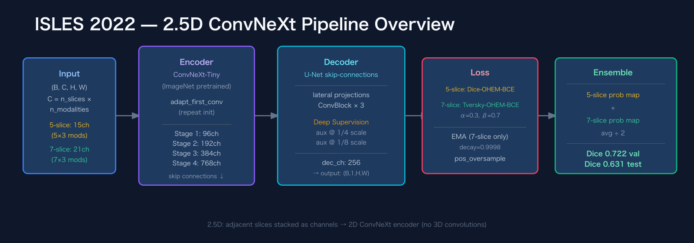
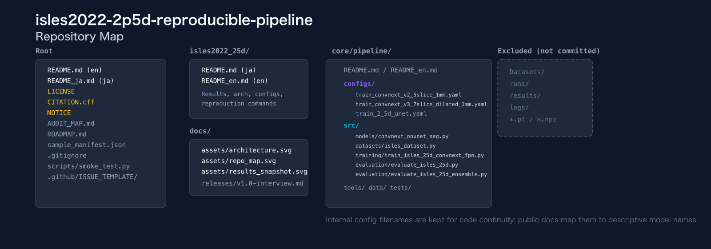
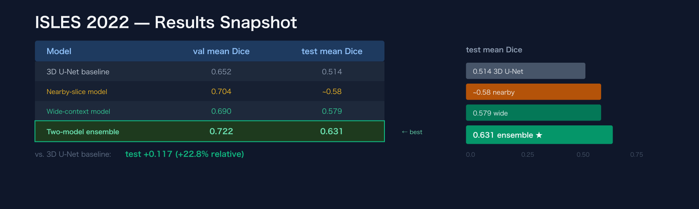

# isles2022-2p5d-reproducible-pipeline

**Language:** English | [Japanese](README_ja.md)

Reproducible 2.5D ischemic stroke lesion segmentation pipeline for ISLES 2022, with audit-ready documentation, two related segmentation models, and ensemble-based evaluation.

> Research / portfolio only. **Not a medical device.** Medical data are not bundled.

**Quick links**
- English entry: [isles2022_25d/README_en.md](isles2022_25d/README_en.md)
- Japanese entry: [isles2022_25d/README.md](isles2022_25d/README.md)
- Detailed documentation: [isles2022_25d/README_en.md](isles2022_25d/README_en.md)
- Citation: [CITATION.cff](CITATION.cff)
- Release note source: [docs/releases/v1.0-interview.md](docs/releases/v1.0-interview.md)
- Roadmap: [ROADMAP.md](ROADMAP.md)

## What this repository provides

- A reproducible train-evaluate-ensemble workflow for ISLES 2022 lesion segmentation
- Two related segmentation models: a nearby-slice model and a wide-context model
- Ensemble evaluation for a lightweight alternative to full 3D segmentation
- Portfolio-ready documentation for external review
- A no-data smoke test that checks the public bundle without medical data

## Internal filename mapping

Some config files and checkpoint examples still preserve historical internal experiment names. Both models share the same overall design: a ConvNeXt encoder with a U-Net-style decoder.

| Internal name in files | Public-facing meaning |
|---|---|
| `convnext_v2_5slice_1mm` | Nearby-slice model (5 slices) |
| `convnext_v3_7slice_dilated_1mm` | Wide-context model (7-slice dilated) |

## Who this is for

- Hiring managers reviewing medical AI segmentation work
- ML engineers looking for an auditable MRI segmentation baseline
- Researchers looking for a reproducible ISLES-style 2.5D project structure

## Visual overview

<p align="center"></p>

<p align="center"></p>

<p align="center"></p>

### Representative results

| Metric | Value | Why it matters |
|---|---:|---|
| Local test mean Dice | 0.631 | Practical performance snapshot for the bundled 2.5D ensemble recipe |
| Validation mean Dice | 0.722 | Demonstrates stronger in-distribution validation behavior for the two-model ensemble |
| 3D U-Net baseline test Dice | 0.514 | Provides a local comparison anchor |
| Relative gain vs 3D baseline | +22.8% | Shows the benefit of the 2.5D ensemble in the local test setting |

> Notes: values are configuration-dependent and come from the bundled recipe / evaluation notes. Protected medical data is intentionally not included. Research implementation only; **not a medical device**.

## Quickstart

### 1. Verify the repository without medical data

```bash
python scripts/smoke_test.py --use_dummy_data
```

### 2. Inspect the public bundle manifest

```bash
cd core/pipeline
python tools/make_manifest.py
```

### 3. Run full training / evaluation with your own data

- Full guide in English: [isles2022_25d/README_en.md](isles2022_25d/README_en.md)
- Full guide in Japanese: [isles2022_25d/README.md](isles2022_25d/README.md)

## What is included vs excluded

Included:
- source code
- configs
- audit and evaluation documentation
- static summary figures and release-note sources

Not included:
- `Datasets/`
- `runs/`
- `results/`
- `logs/`

## Stable portfolio version

Active development continues in this repository. The stable snapshot used for portfolio and interview review is:

✅ `isles2022-2p5d-v1.0-interview`

## How to cite

See [CITATION.cff](CITATION.cff).

## Commit message convention

Use Conventional Commits (`fix:`, `feat:`, `docs:`, …).
